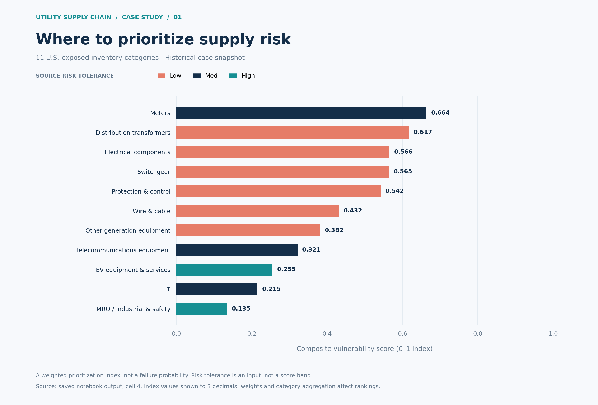
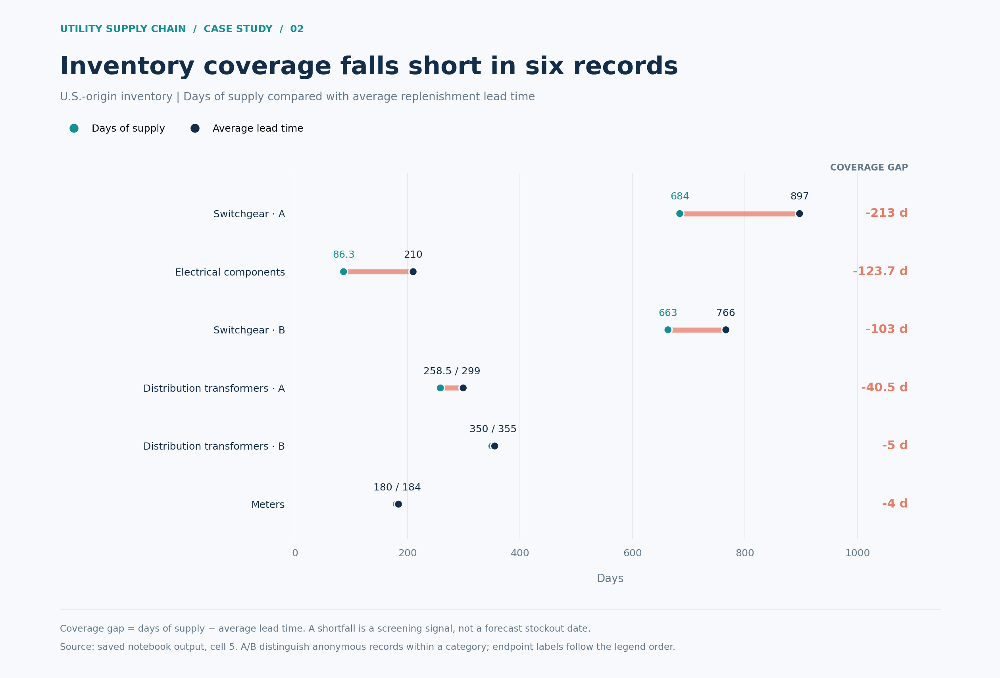
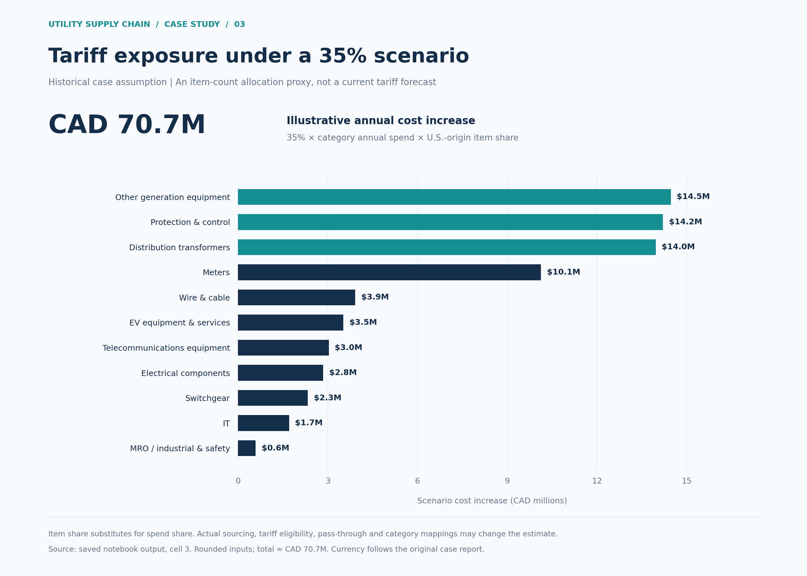
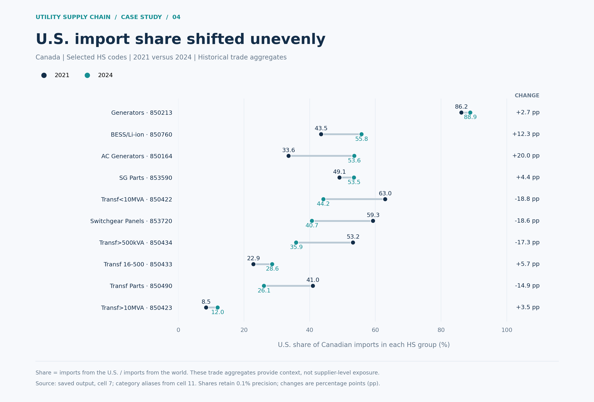
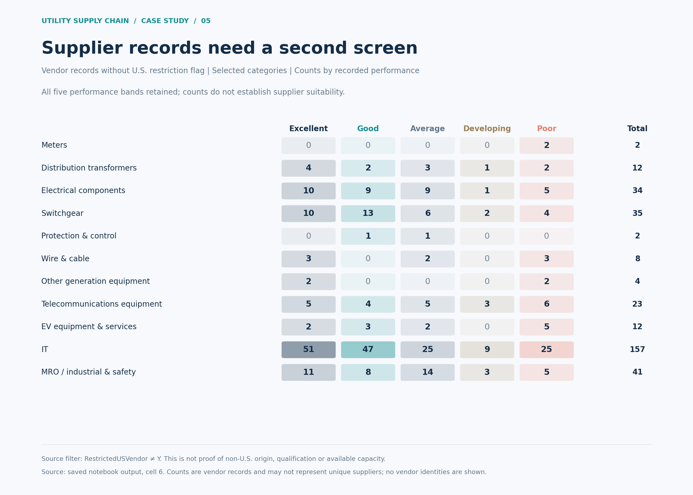

# Utility Supply Chain Resilience

### Tariff exposure, inventory coverage, and sourcing priorities

How should an electric utility respond to a trade-policy shock when critical equipment can take months—or years—to replenish?

This project uses a historical **BC Hydro Ivey course case** to connect financial exposure with operational priorities. The central insight: **the largest modeled tariff costs and the most urgent inventory coverage gaps do not identify the same priorities.** A procurement response needs both views.

**My role: analysis · MMA 608 team project · Python / pandas / Matplotlib**

[Analysis notes](docs/analysis_notes.md) · [Notebook](notebooks/utility_supply_chain_analysis.ipynb) · [Figure source notes](docs/figure_source_notes.md)

## The analytical path

**Trade shock → exposure screen → inventory coverage → priority categories → sourcing response**

The original analysis brought together inventory, vendor, category-spending, and trade information. It examined **291 inventory records**, including **24 U.S.-origin records**. The coverage screen flagged **40 records overall**, including **six U.S.-origin records**, for further review.

## 01 / Where should management focus?



Meters and distribution transformers lead the exploratory Composite Vulnerability Score. The score combines origin exposure, risk tolerance, inventory coverage, a coverage-flag indicator, and lead time. Electrical components and switchgear are almost tied—an invitation to investigate the underlying constraints rather than overinterpret a precise ranking.

*Reading the chart: weights are judgmental; the score is a prioritization aid, not a disruption probability.*

## 02 / Which items need an operational review?



A switchgear record has **684 days of supply against a 897-day average lead time**, leaving a **213-day coverage gap**. The next question is practical: are inbound orders, substitutes, or other buffers sufficient to cover that interval?

*A coverage gap signals prospective replenishment pressure. It does not by itself establish an actual stockout.*

## 03 / How large is the scenario exposure?



The original **35% case scenario** produces approximately **CAD 70.7 million** in annualized exposure. Other generation-station equipment and protection/control equipment contribute the largest amounts, whereas switchgear stands out more strongly in the item-level coverage screen.

*Calculation: category annual spend × U.S.-origin inventory-record share × 35%. Record share is a spending-exposure proxy; this is not an actual tariff bill or a current-policy forecast.*

## 04 / Is the sourcing constraint broader than one utility?



Historical trade data adds an industry perspective. The U.S. share of Canadian imports of the selected generator category reached **88.9% in 2024**. Switchgear panels moved from **59.3% in 2021 to 40.7% in 2024**. Dependence varies substantially by equipment category, so diversification should be assessed product by product.

*These are national import-value shares for selected HS codes, not BC Hydro purchasing shares.*

## 05 / Are alternatives ready to use?



The existence of alternatives is only a starting point. Performance profiles differ across categories; the two meter records in the displayed subset are both rated **Poor**. A useful shortlist must consider technical compatibility, capacity, delivery reliability, and total landed cost.

*The subset uses the case's U.S.-restriction flag, not independently verified supplier nationality. Counts represent vendor-table records; all five performance categories are shown.*

## From analysis to action

| Horizon | Recommended focus |
| --- | --- |
| Near term | Review coverage flags against inbound orders, operational needs, and available substitutes. |
| Medium term | Qualify alternative suppliers and evaluate parallel sourcing for critical equipment. |
| Long term | Improve sourcing diversity and inventory visibility across exposed categories. |

These are case recommendations. The project does not claim implementation or realized savings.

## Origin and contribution

Completed as a team assignment for **MMA 608 — Business Applications of AI (Operations and Supply Chain), University of Alberta**, using Ivey's [*BC Hydro: Navigating Supply Chain Uncertainty amid Tariffs*](https://www.iveypublishing.ca/s/product/bc-hydro-navigating-supply-chain-uncertainty-amid-tariffs/01tOF00000BWq3ZYAT).

The original report credits **Miao Jiang, Tong Xiao, and Wenchuan Zhu**. **My contribution was the analysis.** This repository curates that work into a visual portfolio with refreshed charts and concise methodological explanations. It represents academic case analysis, not a consulting engagement with BC Hydro.

## Explore or reproduce

The five figures can be regenerated from selected results preserved in the original notebook's saved summary outputs:

```bash
python -m pip install -r requirements.txt
python scripts/build_figures.py
```

The [curated notebook](notebooks/utility_supply_chain_analysis.ipynb) documents the underlying analysis. Rerunning it requires an independently authorized copy of the case workbook; see [data access](data/README.md). The original case text, workbook, teaching note, and full team report are not distributed here.

```text
utility-supply-chain-risk-analysis/
├── README.md
├── assets/                     # Five portfolio figures
├── data/README.md              # Private-input instructions
├── docs/
│   ├── analysis_notes.md
│   └── figure_source_notes.md
├── notebooks/
│   └── utility_supply_chain_analysis.ipynb
├── scripts/build_figures.py    # Render figures from saved summary results
├── requirements.txt
└── .gitignore
```
